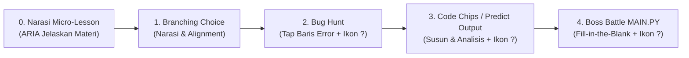

# Desain Engine Gameplay Interaktif & Aset Visual — Code of The Mystery

> **Versi:** 2.0 (Redesign Interaktif Ch. 1–7)  
> **Tanggal:** 24 November 2026  
> **Status:** Dokumen Desain untuk Review (sebelum implementasi kode Kotlin)

---

## 1. Mengapa Bukan Hyperframes / Remotion untuk Gameplay?

| Aspek | Hyperframes / Remotion (*Code-to-Video*) | Jetpack Compose Interactive Engine *(Dipilih)* |
| :--- | :--- | :--- |
| **Output** | Video statis (`MP4`/`WebM`) | UI & Canvas real-time `60 FPS` yang dikendalikan state Kotlin |
| **Interaksi Pemain** | Nol (pemain hanya menonton sampai video selesai) | Penuh: tap dialog bercabang, pilih bug, tap *Code Chips*, isi `MAIN.PY`, pakai *Potion* kapan saja |
| **Ukuran APK** | Membengkak puluhan MB jika tiap adegan bervideo | Ringan (~beberapa MB aset gambar + procedural particle Canvas) |
| **Kapan Video Boleh Dipakai?** | Opsional hanya untuk *Intro Trailer* / *Chapter Opening Bumper* 3–5 detik via `Media3 ExoPlayer` | Semua momen pertempuran, dialog, & coding tetap 100% real-time |

---

## 2. Solusi Masalah Gameplay Saat Ini ("Kaku, Singkat, dan Terlalu Mudah")

Empat kelemahan utama pada prototipe awal (`SpriteViewport.kt` + `AppSeedData.kt` v1) diperbaiki total melalui arsitektur berikut:

1. **Sprite PNG Kaku → *Compose Physics & FX Engine*:**
   - **Hero Lunge & Knockback:** Menggunakan `Animatable<Float>` untuk menggeser karakter maju saat menyerang (`SKILL_1` / `SKILL_2`) dan mundur saat terkena *hit*.
   - **Enemy HP Bar & Status Effects:** Musuh tidak langsung mati dalam 1 klik; setiap musuh/boss memiliki **Enemy HP Bar** (mis. `100/100` atau `200/200`), status (`SHIELDED`, `EXPOSED`, `ENRAGED`), dan *weakness* yang bisa dibuka lewat **Clue**.
   - **Screen Shake & Hit Flash:** Layar bergetar singkat (`offset` sinusoidal 250ms) + *red/lavender tint flash* saat damage terjadi.
   - **Canvas Particle System:** Efek tebasan kode, percikan listrik Drone, retakan perisai Golem, dan *floating damage numbers* (`-50 DMG`, `CRITICAL!`, `BLOCKED BY SHIELD!`).
2. **Kode `MAIN.PY` Sudah Terisi Penuh → *Cloze / Fill-in-the-Blank (`____`) + Hint Clue*:**
   - Pada kode `starterCode`, bagian kunci **sengaja dikosongkan** dengan placeholder interaktif (mis. `nama = ____`, `if energy ____ 50:`, `return ____`).
   - Pemain harus mengganti token `____` (baik mengetik langsung maupun mengetuk **Code Chips** rekomendasi/pengecoh) berbekal **Clue** yang ditemukan pada Act 1–2.
   - Jika masih ada token `____` yang belum diisi, tombol **`Jalankan`** menolak dengan peringatan logis (`SyntaxError: slot ____ belum dilengkapi!`) dan tidak otomatis lolos.
3. **Chapter Terlalu Singkat & Kurang Konteks Materi → *Struktur 5 Act + Micro-Lesson Sebelum Soal + Tombol Bantuan `"?"`*:**
   - Setiap tantangan **wajib didahului narasi penjelasan materi oleh ARIA/karakter** tepat di dalam cerita (*Micro-Lesson → Challenge*), sehingga pemain tidak langsung dilempar ke soal tanpa paham konsepnya.
   - Di setiap panel soal yang sedang dikerjakan (*Bug Hunt*, *Predict Output*, *Code Chips*, *Quiz*, dan *`MAIN.PY`*), tersedia **logo/tombol bantuan `"?"`** di pojok kanan atas kartu soal untuk membuka **Popup Referensi Materi** kapan saja secara gratis (berbeda dari tombol *Hint* yang memberi petunjuk jawaban).
   - Setiap chapter (Ch. 1–7) mengikuti pacing 5 Act:
     - **Act 1 — Anomaly Opening & Micro-Lesson 1:** Pengenalan distrik baru, dialog dinamis Hero + **ARIA** yang mengajarkan konsep dasar chapter, dan pembukaan **Clue Utama**.
     - **Act 2 — Branching Encounter & Clue Rahasia:** Pertemuan dengan **Vex ("Null")**, NPC, atau sistem keamanan dengan **Pilihan Bercabang** (*Patch* vs *Purge* / *Analisis* vs *Terobos*) yang memengaruhi bonus Clue, HP, atau kelemahan Boss.
     - **Act 3 — Pre-Battle Micro-Lesson & Skirmish Mini-Puzzle:** ARIA memberi penjelasan praktis singkat (*mis. aturan operator atau jebakan syntax umum*) tepat sebelum pertarungan *minion* (**Bug Hunt** & **Predict Output / Code Chips**).
     - **Act 4 — Boss Briefing & Multi-Phase Boss Battle:** Pengajaran konsep inti Boss oleh ARIA sebelum pertempuran puncak (**Enemy HP Bar** terbagi 2 fase: Fase 1 membuka *Shield*; Fase 2 Live Coding `MAIN.PY` *Fill-in-the-Blank* untuk *Finisher*).
     - **Act 5 — Loot Box, Resolution & Cliffhanger:** Klaim peti **Loot Box**, ringkasan alignment/XP, dan transisi cerita ke chapter berikutnya.

---

## 3. Empat Variasi Tantangan Interaktif & Tombol Bantuan `"?"`

### Perbedaan Tombol Bantuan `"?"` vs Tombol `Hint` (`Laptop`)
| Fitur | Logo Bantuan **`"?"`** *(Help Materi)* | Tombol **`Hint`** *(Ikon Lampu / Laptop)* |
| :--- | :--- | :--- |
| **Lokasi** | Pojok kanan atas header **semua soal** (*Bug Hunt*, *Predict Output*, *Code Chips*, *Quiz*, dan *`MAIN.PY`*) | Header panel **`MAIN.PY`** (aktif saat `Laptop` terpasang) |
| **Isi Popup/Modal** | Ringkasan **teori & contoh sintaks** materi yang sedang diuji pada soal tersebut | Petunjuk **spesifik baris/nilai** apa yang harus diisi pada slot `____` soal ini |
| **Batasan** | Gratis, tanpa batas klik, tidak mengurangi HP/XP | Opsional sebagai fitur pasif item `Laptop` |

| Mode Tantangan | Cara Main di Layar HP | Feedback di Viewport |
| :--- | :--- | :--- |
| **1. Branching Choice** | Muncul 2–3 tombol pilihan dialog di bawah kotak narasi. | Mengubah respons **ARIA/Vex**, menyimpan flag `alignment` (*Patch* vs *Purge*), dan membuka **Clue Rahasia** atau **Boss Weakness**. |
| **2. Bug Hunt (Tap-the-Line)** | Ditampilkan 5–7 baris kode bernomor; pemain mengetuk baris yang menyebabkan bug (mis. lupa `:`, salah indentasi, tipe data salah). | Benar → Hero melakukan *counter-slash* (`-35 Enemy HP`). Salah → Enemy menyerang balik (`-1 Player HP`). |
| **3. Code Chips & Predict Output** | Pemain mengetuk keping kode (*chips*) untuk mengisi celah logika atau menebak output terminal dari potongan kode. | Benar → `ESPRIT` naik, perisai musuh retak (`EXPOSED`). Salah → *Screen Shake* + penalti HP. |
| **4. Fill-in-the-Blank `MAIN.PY`** | Editor `MAIN.PY` memuat kode dengan slot `____`. Pemain mengetuk slot atau mengetik kode pengganti + bantuan `Hint` (`Laptop`) & `Clue Log`. | Saat `Jalankan` sukses → `Exit Code 0`, animasi `SKILL_2` + partikel ledakan + Boss HP turun ke `0`! |

---

## 4. Sistem Branching & Alignment (*Patch vs Purge*)

Setiap pilihan penting sepanjang Chapter 1–7 dicatat ke dua metrik tersembunyi (yang dapat dilihat di layar ringkasan chapter):
- **Patch Score (Keseimbangan / Debugging):** Pendekatan analitis, melindungi warga/sistem, mencari akar bug sebelum bertindak.
- **Purge Score (Agresif / Overclock):** Pendekatan cepat, berisiko tinggi, menghapus anomali secara paksa (sejalan dengan filosofi **Vex**).
- **Secret Clues Found (`0..7`):** Clue tersembunyi dari pilihan investigasi yang membuka *True Kernel Ending* di Chapter 7.

---

## 5. Rencana Generasi Aset Visual Kreatif (Custom Pixel-Art Cyberpunk)

Karena aset tidak lagi terbatas pada potongan PNG Figma yang ada, seluruh aset visual di bawah dapat di-generate seragam dengan gaya **16-bit / HD Cyberpunk Pixel-Art** (palet gelap `#0C0E12` + aksen neon ungu `#C799FF` & cyan `#38BDF8`):

### A. Karakter & Ekspresi Potret (Portrait Bust untuk Kotak Dialog)
1. **Protagonis (The Mystery Coder):** `hero_portrait_neutral`, `hero_portrait_shocked`, `hero_portrait_determined` (mantel panjang gelap, kacamata/rambut acak, laptop menyala ungu).
2. **ARIA (AI Companion):** `aria_orb_idle`, `aria_orb_alert`, `aria_hologram` (orb hologram cyan-lavender dengan simbol `{ }`).
3. **Vex / "Null" (Rival Hacker):** `vex_portrait_smirk`, `vex_portrait_serious`, `vex_sprite_battle` (jaket techwear hitam-merah, visor neon crimson).

### B. Background Distrik per Chapter (`16:9` Viewport)
1. **Ch. 1:** `bg_ch1_dokja_street` (sudah ada) & `bg_story_error` (sudah ada).
2. **Ch. 2:** `bg_ch2_subway_firewall` — Peron stasiun kereta bawah tanah neon dengan gerbang laser ungu.
3. **Ch. 3:** `bg_ch3_clockwork_spire` — Menara server raksasa penuh roda gigi digital yang membeku dalam loop.
4. **Ch. 4:** `bg_ch4_memory_vault` — Gudang arsip kubus data melayang (*Black-Market Memory Vault*).
5. **Ch. 5:** `bg_ch5_relay_tower` — Puncak menara pemancar sinyal di tengah badai petir kode biner.
6. **Ch. 6:** `bg_ch6_blueprint_citadel` — Katedral arsitektur wireframe putih-ungu tempat cetak biru objek dunia dibuat.
7. **Ch. 7:** `bg_ch7_null_kernel` — Inti ruang hampa *The Great Runtime Error* dengan portal kode sumber raksasa.

### C. Sprite Musuh & Boss Unik Ch. 1–7
1. **Ch. 1:** `enemy_slime_glitch` (mini) & **Golem** (sudah ada — *Syntax Stone Golem*).
2. **Ch. 2:** **Rogue Surveillance Drone** (sudah ada — *Firewall Sentinel*).
3. **Ch. 3:** **Loop Titan / Chronos Golem** (Boss roda gigi waktu + armor perunggu-neon).
4. **Ch. 4:** **Cache Phantom** (Monster bayangan kotak memori bersinar cyan-merah).
5. **Ch. 5:** **Vex (Signal Hijacker Duel)** (Pertarungan langsung melawan rival).
6. **Ch. 6:** **Corrupted Architect** (Sosok berjubah wireframe dengan perisai Class Blueprint).
7. **Ch. 7:** **The Null Kernel (Final Boss)** (Entitas raksasa bermata kode error hexadecimal `0xDEADCODE`).
