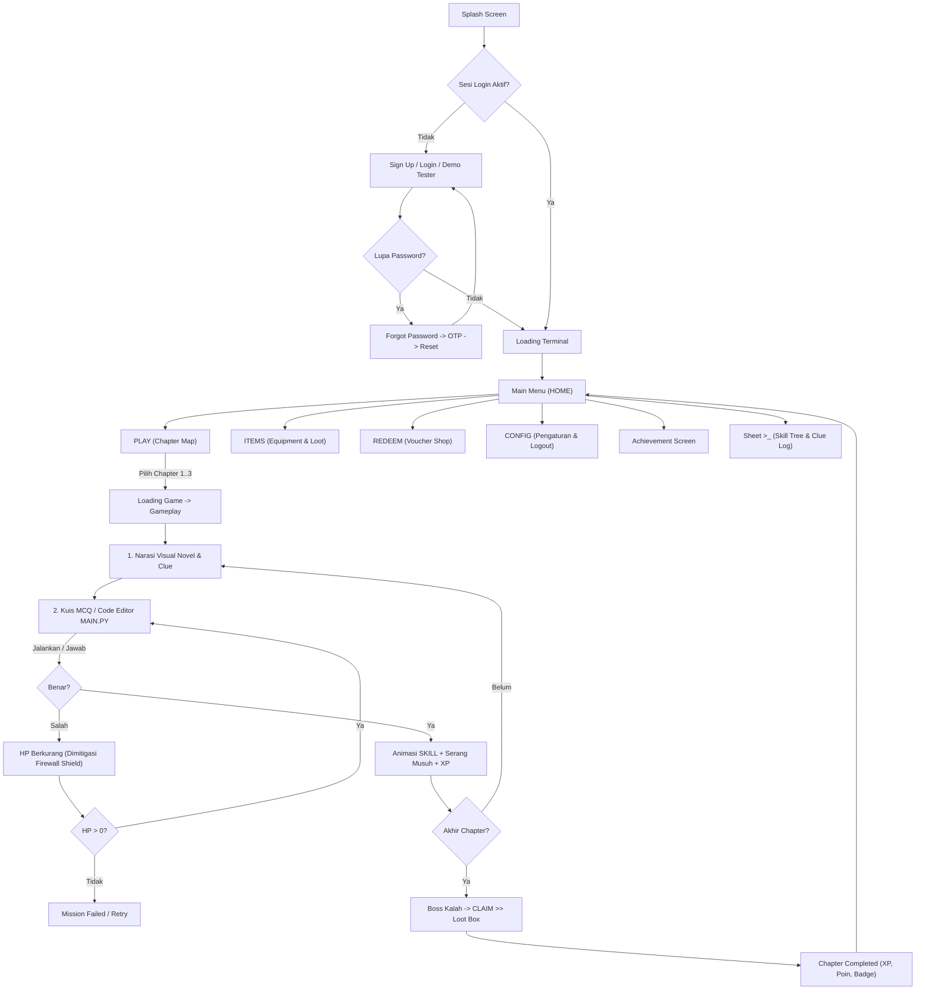

# Product Requirements Document (PRD) — Code of The Mystery

> **Versi Dokumen:** 1.0  
> **Tanggal:** 20 November 2026  
> **Nama Proyek:** Code of The Mystery (Figma Workspace: `UX Coftery`)  
> **Target Platform:** Android Native (Kotlin + Jetpack Compose)  
> **Tim Penyusun (Kelompok 6 — Sistem Informasi Reguler 4A, Fakultas Ilmu Komputer, Universitas Sriwijaya):**
> - Dinda Misi Islami (`09031382429127`)
> - Syawaluddin Boy Rambe Al Ayyubi (`09031282429097`)
> - Muhammad Faiz Athallah (`09031282429040`)
> - Muhammad Ali Dzaki Arridho (`09031282429124`)
> - Rewina Rakha Phelia Paramesti (`09031182429115`)

---

## 1. Ringkasan Eksekutif

**Code of The Mystery** adalah aplikasi pembelajaran pemrograman berbasis Android (*mobile*) yang menggabungkan pendekatan **Educational RPG**, narasi **Visual Novel**, dan **praktik coding langsung** di dalam satu pengalaman interaktif bertema *"Learn, Play, and Earn"*.

Aplikasi ini mengubah materi pemrograman yang abstrak menjadi petualangan misteri bergaya *dark cyberpunk* (terinspirasi dari *Omniscient Reader's Viewpoint* dan terminal sistem) pada dunia yang dilanda fenomena **"The Great Runtime Error"**. Pengguna berperan sebagai *"The Mystery Coder"* yang memecahkan teka-teki logika dan menulis kode **Python** (`MAIN.PY`) untuk mengalahkan anomali seperti *Drone* dan *Golem*, mengumpulkan XP, membuka *equipment*, meraih *achievement*, serta menukarkan poin dengan insentif digital nyata (*voucher* & langganan layanan).

Dokumen PRD ini menyatukan:
1. Konsep & justifikasi UX dari dokumen [UX - Code of The Mystery.md](file:///c:/Users/ACER/Downloads/UX%20-%20Code%20of%20The%20Mystery.md).
2. Alur interaksi dan sistem visual dari prototipe Figma **UX Coftery** (`Default` flow + `Page 2 ASSET`).
3. Keputusan arsitektur dan ruang lingkup implementasi UAS Mobile Programming hasil sesi penyelarasan teknis.

---

## 2. Latar Belakang & Justifikasi Masalah

Berdasarkan perancangan UX sebelumnya, terdapat empat masalah utama dalam pembelajaran pemrograman bagi mahasiswa IT maupun non-IT:

| No | Masalah | Dampak pada Mahasiswa | Solusi di Code of The Mystery |
| :--- | :--- | :--- | :--- |
| 1 | **Metode Konvensional Satu Arah** | Cepat jenuh saat hanya membaca teks modul atau slide teori. | **Narrative Learning Path**: materi dibungkus dalam dialog Visual Novel interaktif dan skenario misteri. |
| 2 | **Abstraksi Konsep Pemrograman** | Sulit membayangkan alur variabel, percabangan, maupun logika program secara nyata. | **Visualisasi Battle & Analoginya**: eksekusi kode langsung memicu serangan/skill karakter di viewport RPG. |
| 3 | **Minimnya Apresiasi Instan** | Motivasi menurun karena hasil belajar baru terasa di akhir semester berupa nilai angka. | **Milestone Reward Center (`Redeem`)**: XP, level, badge, item loot, dan penukaran poin ke voucher digital. |
| 4 | **Coding Anxiety (Takut Error)** | Mahasiswa cemas/tertekan saat berulang kali menemui pesan error saat praktik coding. | **Sistem HP `6/6` & Armor (`Firewall Shield`)**: kesalahan diperlakukan sebagai tantangan game yang bisa dimitigasi oleh item pertahanan. |

---

## 3. Target Pengguna & Persona

1. **Mahasiswa Pemula / Non-IT (Primary Persona)**
   - Membutuhkan pengenalan sintaks dasar (*variabel, tipe data, kondisi, perulangan*) dengan bahasa yang ringan, visual, dan tidak mengintimidasi.
2. **Mahasiswa IT / Pengambil MK Pemrograman (Secondary Persona)**
   - Menginginkan tantangan praktik coding langsung (*Boss Battle*), progres terukur (*Skill Tree* & *Achievement*), serta motivasi tambahan berupa poin/voucher.
3. **Dosen / Penguji Demo UAS (Evaluator Persona)**
   - Membutuhkan akses cepat untuk menguji seluruh alur aplikasi (Auth, Gameplay, Code Editor, Equipment, Redeem, Achievement) tanpa harus melakukan *grinding* poin dari awal (difasilitasi melalui fitur **Akun Demo Tester**).

---

## 4. Penyelarasan Desain (Dokumen `.md` × Figma × Keputusan Teknis)

Untuk memastikan implementasi mobile selaras dengan rancangan UX dan realistis diselesaikan dalam proyek UAS kelompok, ditetapkan penyelarasan sebagai berikut:

| Aspek | Dokumen `.md` | Prototipe Figma (`UX Coftery`) | Keputusan Final Produk (Phase 1 UAS) |
| :--- | :--- | :--- | :--- |
| **Bahasa Materi** | Menyebut Java / OOP & DSA | Menggunakan **Python** (`MAIN.PY`, *Perkenalan kepada bahasa pemrograman Python*) | **Python** sebagai bahasa materi utama agar konsisten 100% dengan UI dan editor `MAIN.PY` di Figma. |
| **Mekanik Tantangan** | Kuis pilihan ganda (HP `6/6`, salah `-1 HP`, Armor buff) + Coding Boss Battle | Dialog Visual Novel + Code Editor `MAIN.PY` + Output + `lifebar` & `DEATH` di aset | **Gabungan keduanya**: Dialog VN → Kuis MCQ / Coding `MAIN.PY` dengan **HUD HP `6/6`** dan efek pengurang damage dari **Armor (`Firewall Shield`)**. |
| **Cakupan Chapter** | Multi-chapter berjenjang | `PLAY` menampilkan peta Chapter (Ch.1 terbuka, Ch.2+ terkunci) | **3 Chapter playable penuh** (Ch.1 Variabel & Tipe Data, Ch.2 Kondisi `if/else` vs Drone, Ch.3 Boss Battle Golem) + Ch.4–7 tampil sebagai roadmap terkunci. |
| **Backend & Auth** | Integrasi partner & akun | Layar `Sign Up`, `Login` (Google/FB), `Forgot Password` OTP, `Redeem` | **Phase 1: Offline-first** (Room + DataStore) dengan Auth lokal & placeholder OAuth; disiapkan *Repository abstraction* untuk integrasi **Express + JWT** di Phase 2. |
| **Eksekusi Kode** | In-App Code Editor + Real-time Validation | Panel `MAIN.PY` + tombol `Jalankan` + panel `OUTPUT` | **Custom Compose Code Editor + Mini Python Evaluator lokal di Kotlin** (tanpa bloat ukuran APK). |
| **Skill Tree & Clues** | Disebut di Profile & Narrative Learning | Tersedia layar `Achievement` + tombol ikon terminal `>_` di header | **Achievement** otomatis terbuka dari progres + panel/sheet **Skill Tree & Clue Log** diakses lewat ikon `>_` di header & Pause. |

---

## 5. Ruang Lingkup & Roadmap Rilis

### Phase 1 — Mobile-First UAS MVP (Fokus Saat Ini)
- Aplikasi Android Kotlin + Jetpack Compose berjalan penuh secara **offline-first** (Room + DataStore).
- Seluruh alur utama Figma (`Splash`, `Auth`, `Loading`, `Main Menu`, `PLAY`, `Gameplay`, `Items`, `Redeem`, `Achievement`, `Config`) fungsional penuh dengan data persisten lokal.
- 3 Chapter playable lengkap dengan animasi sprite RPG lokal, Mini Python Evaluator, HUD HP `6/6`, Loot Box, Voucher History, Skill Tree, dan Clue Log.
- Tombol **Masuk sebagai Demo Tester** di halaman Login untuk pengujian cepat.

### Phase 2 — Integrasi Backend & Ekspansi Konten (Pasca-UAS / Pengembangan Lanjutan)
- Integrasi REST API **Express.js + JWT Authentication** (mengganti local datasource di balik interface `Repository`).
- OAuth Google & Facebook aktif secara penuh.
- Sinkronisasi *leaderboard*, stok voucher real-time dari server mitra, dan pembukaan Chapter 4–7 (Loop, Fungsi, List/Dict, Dasar OOP Python).

---

## 6. Alur Pengguna Utama (*User Flow*)

---

## 7. Spesifikasi Fitur Produk (Detail)

### 7.1 Onboarding & Autentikasi
1. **Splash Screen**: Logo diamond `{ }` neon ungu, judul `CODE OF THE MYSTERY`, subjudul `learn, play, and earn`, transisi otomatis ke layar Auth atau langsung ke Main Menu jika sesi aktif.
2. **Sign Up**: Input `Nama`, `Email`, `Password`, `Konfirmasi Password`, validasi format & kecocokan password, tombol `Sign Up`, link ke `Login`, serta tombol placeholder OAuth Google & Facebook.
3. **Login**: Input `Email`, `Password` (dengan toggle visibility), link `Lupa password?`, tombol `Login`, tombol **Masuk sebagai Demo Tester** (memuat akun pra-isi dengan `15.000 Poin`, `Level 2`, dan `Firewall Shield` untuk demo), serta placeholder OAuth Google/Facebook (menampilkan dialog informasi bahwa OAuth disiapkan untuk integrasi backend Express).
4. **Forgot Password**: Alur 3 langkah sesuai Figma — Konfirmasi Email → Input Kode OTP 6 digit (simulasi OTP lokal) → Setel Ulang Password Baru → `loading pw` → kembali ke `Login`.
5. **Loading Terminal**: Animasi log terminal (`SYS_BOOT_ENV_V1.0`, `Initializing Terminal... [OK]`, `Decrypting User Profile...`, `Synchronizing XP... 0x7F`) dengan circular progress loader.

### 7.2 Main Hub (`Main Menu` / `HOME`)
- **Top Bar**: Judul `Code of the Mistery` dan tombol ikon terminal `>_` (membuka **Terminal Sheet** berisi *Skill Tree* & *Clue Log*).
- **Kartu Profil Pemain**:
  - Nama pengguna, gelar dinamis berdasarkan level (contoh: `LEVEL 2 VIBE CODER`), progress bar XP (`currentXp / nextLevelXp`), serta 3 metrik ringkas: `Poin Terkumpul`, `Chapter Terselesaikan (x/7)`, dan `Pencapaian Didapatkan (x/50)`.
- **Kartu `Current Chapter`**: Menampilkan chapter aktif terakhir yang terbuka (misal: *Chapter I: Mastering Logic, Surviving Syntax — Perkenalan kepada bahasa pemrograman Python*) dengan tombol **`PLAY`** menuju Peta Chapter.
- **Kartu Shortcut**: Akses cepat ke **Items**, **Achievements**, dan **Redeem Your Points**.
- **Bottom Navigation Bar**: 4 tab utama tetap: `HOME`, `ITEMS`, `REDEEM`, `CONFIG`.

### 7.3 Peta Chapter (`PLAY`) & Kurikulum 3 Chapter Playable
Menampilkan jalur node melengkung dari Chapter 1 hingga Chapter 7:
1. **Chapter 1 — *Mastering Logic, Surviving Syntax* (Unlocked awal)**:
   - *Materi*: Pengenalan sintaks Python, komentar (`#`), variabel, dan tipe data dasar (`string`, `integer`, `float`, `boolean`), `print()`.
   - *Skenario & Musuh*: Prolog *"The Great Runtime Error !!"* di `Dokja Supermarket` → tutorial assignment variabel (`nama`, `HP`, `skill`) → pertarungan melawan **Golem** menggunakan kondisi awal (`energy`, `shields_active`, `total_power`).
2. **Chapter 2 — *Branching Protocol, Break the Firewall* (Terbuka setelah Ch.1 selesai)**:
   - *Materi*: Operator perbandingan (`>`, `<`, `==`, `!=`) dan percabangan (`if / elif / else`).
   - *Skenario & Musuh*: Penyusupan sektor sistem → menghadapi **Rogue Drone** (`DRONE SERANG` / `DRONE MATI`) dengan kuis logika dan tantangan coding percabangan.
3. **Chapter 3 — *Looping the Anomaly, Final Decryption* (Terbuka setelah Ch.2 selesai)**:
   - *Materi*: Perulangan (`for` / `while`) dan fungsi sederhana (`def`) sebagai **Boss Battle**.
   - *Skenario & Musuh*: Boss Battle melawan **Armored Core Golem** dengan mekanik multi-stage (kuis + coding boss challenge).
4. **Chapter 4 s/d 7 (Locked Roadmap)**:
   - Ditampilkan dengan ikon gembok (`🔒`) dan deskripsi pratinjau (*Data Structures*, *Functions & Modules*, *OOP Basics*, *Algorithm Boss*) serta pesan *"Selesaikan chapter sebelumnya / Segera hadir di ekspansi berikutnya"*.

### 7.4 Gameplay Engine (Visual Novel + Battle + Code Editor)
Layar gameplay dibagi menjadi **3 zona vertikal** sesuai prototipe Figma:
1. **Top Bar & RPG Viewport (Atas)**:
   - Top bar: Tombol **Pause (`||`)** (membuka modal `Paused`: *Lanjutkan*, *Lihat Clue/Skill*, *Keluar ke Menu*), judul chapter aktif, serta **HUD HP `6/6`** + badge status buff aktif (`Firewall Shield`) dan indikator `+FORCE` / `+ESPRIT`.
   - Viewport pixel-art beranimasi: Background adegan (*glitch city*, *Dokja Supermarket*), karakter hero (`IDLE`, `WALK`, `RUN`, `SKILL 1`, `SKILL 2`, `DEATH`), musuh (`DRONE`, `GOLEM`), dan overlay window dialog sistem bergaya RPG biru.
2. **Panel Interaktif (Tengah)** — berganti sesuai fase *scene*:
   - **Fase Narasi Visual Novel**: Kotak dialog karakter/narator dengan efek teks bertahap (*typewriter*) yang memuat penjelasan materi (*micro-lesson*) sebelum soal muncul, serta indikator *"Clue Baru Tersimpan"* saat poin materi penting muncul.
   - **Fase Kuis / Mini-Puzzle & Tombol Bantuan (`?`)**: Pertanyaan logika / *Bug Hunt* / *Code Chips* dengan **ikon bantuan `?`** di pojok header kartu soal untuk membuka referensi materi singkat topik yang sedang diuji kapan saja. Jawaban benar menyerang musuh; jawaban salah mengurangi HP.
   - **Fase Coding (`MAIN.PY`)**: Penjelasan singkat materi + **ikon bantuan `?`** di header editor, diikuti **Code Editor `MAIN.PY`** dengan slot *fill-in-the-blank* (`____`), line/syntax coloring sederhana, tombol `Hint`, dan tombol **`Jalankan`**. Setelah dijalankan, panel berubah/menampilkan **`OUTPUT`** terminal (`Code Executed Successfully With Exit Code 0;` atau pesan error edukatif jika gagal).
3. **Quick Item Bar (Bawah)**:
   - Menampilkan **3 slot item yang sedang dipakai** (`Laptop`, `Firewall Shield`, slot ke-3 seperti `Syntax Potion`). Item *consumable* seperti `Syntax Potion` bisa diketuk langsung saat battle untuk memulihkan HP (`+4 HP`, maksimal `6/6`).
4. **Reward & Akhir Chapter**:
   - Saat musuh/boss tumbang, muncul tombol **`CLAIM >>`** di viewport untuk membuka **Loot Box** (item baru + Rarity), lalu layar **`Chapter Completed`** (menampilkan `XP`, `Points`, `Soal Terjawab`, dan badge baru jika terbuka) → tombol `Kembali ke beranda`.
   - Jika HP mencapai `0/6`, muncul layar **System Crash / Mission Failed** dengan opsi *Coba Lagi Chapter* atau *Kembali ke Menu*.

### 7.5 Inventory & Equipment (`Items`)
- **Item yang Dipakai**: 3 slot visual di bagian atas halaman (`Slot 1`, `Slot 2`, `Slot 3`).
- **Daftar Item Tersedia**:
  - `Laptop` (`DEFAULT ITEM`, status `Can't be Unequip`): memberikan fitur *Code Hint* / membuka akses editor `MAIN.PY`.
  - `Firewall Shield` (`Def +120`, bisa `Equip`/`Unequip`): **Passive Armor Buff** — mengurangi penalti pengurangan HP saat salah menjawab atau salah mengeksekusi kode (atau menahan damage pertama di setiap chapter).
  - `Syntax Potion` (`HP +4`, `QTY xN`, consumable): bisa di-equip ke slot ke-3 dan digunakan saat battle untuk memulihkan HP.
  - Item tambahan dari **Loot Box** (misal: *Debugger Visor*, *Overclock Core*) dengan **Item Rarity** (`Common`, `Rare`, `Epic`).
  - Slot/item yang belum terbuka tampil terkunci (`Item ini masih terkunci`).

### 7.6 Milestone Reward Center (`Redeem`)
- **Saldo Poin**: Kartu `POIN KAMU` menampilkan total poin pemain secara real-time, serta tombol **Riwayat Voucher** di pojok atas daftar.
- **Katalog Hadiah Digital** (sesuai Figma):
  1. `Shopee Rp70k Voucher` — `10,000 Points`
  2. `Tokopedia Rp50k Voucher` — `7,000 Points`
  3. `Dana Rp50k` — `10,000 Points`
  4. `GitHub Copilot (1 Bulan)` — `40,000 Points`
  5. `ChatGPT Plus (1 Bulan)` — `55,000 Points` (`Stok tersisa 4`)
- **Mekanisme Penukaran**:
  - Jika poin cukup → tampil **Modal Konfirmasi** (`Poin Anda`, `Harga`, `Sisa`, catatan *"Tidak dapat di refund"*, tombol `Tukar` & `Batal`).
  - Saat dikonfirmasi → poin berkurang secara atomik, stok berkurang (jika terbatas), sistem membuat **kode voucher simulasi unik** (mis. `COTM-SHP-XXXX`), menyimpannya ke **Riwayat Voucher**, dan menampilkan `Modal Success` (*"Berhasil — Kode voucher tersimpan di Riwayat & disimulasikan terkirim ke email Anda"*).
  - Jika poin kurang → tampil `Modal Poin Tidak Cukup` (*"Maaf, poin Anda tidak cukup"*).

### 7.7 Achievement, Skill Tree & Clue Collection
- **Halaman `Achievement`**:
  - Kartu `STATUS OPERASIONAL`: Level saat ini, XP bar, jumlah badge aktif (`x/N`).
  - `Log Pencapaian` dengan progress bar masing-masing badge yang ter-update otomatis dari gameplay:
    - `Variable Explorer 1` (`+150 XP`) — Selesaikan tantangan assignment variabel (Ch.1).
    - `Bug Hunter` (`+200 XP`) — Selesaikan chapter atau kalahkan musuh tanpa kehabisan HP / minim error.
    - `Algorithm Wizard` (`+300 XP`) — Selesaikan tantangan logika/Boss Battle.
    - `Variable Explorer 2` & badge tambahan untuk Ch.2–Ch.3 serta milestone Redeem/Loot.
- **Terminal Sheet (`>_`) — Skill Tree & Clue Log**:
  - Dapat dibuka dari ikon `>_` di pojok kanan atas (`Home`, `Items`, `Redeem`, `Achievement`, `Config`) atau dari menu `Pause` in-game.
  - Tab **Skill Tree**: Visualisasi cabang penguasaan materi Python (*Syntax & Variables* → *Conditional Logic* → *Loops & Functions* → *OOP Preview*).
  - Tab **Clue Log**: Kumpulan kartu catatan materi ("petunjuk") yang sudah ditemukan pemain selama dialog Visual Novel agar mudah diulang sebelum Boss Battle.

### 7.8 Pengaturan (`Config`)
- Daftar menu bersih sesuai Figma:
  - **Akun**: Lihat/ubah nama tampilan & status akun (atau identifikasi apakah sedang memakai mode Demo Tester).
  - **Privasi dan Keamanan**: Ubah password lokal & kebijakan data offline.
  - **Tentang dan Bantuan**: Informasi versi aplikasi, kredit Kelompok 6 Unsri, serta panduan bermain singkat.
  - **Preferensi Tambahan**: Toggle Haptic Feedback & Reset Data Demo (khusus pengujian UAS).
  - **Logout**: Menghapus sesi aktif di DataStore dan mengarahkan kembali ke `Splash Screen` / `Login`.

---

## 8. Design System & Visual Guidelines (Referensi Figma `UX Coftery`)

| Token | Nilai Hex | Penggunaan |
| :--- | :--- | :--- |
| `BackgroundPrimary` | `#0C0E12` | Latar belakang utama seluruh layar |
| `SurfaceCard` | `#13161C` | Kartu profil, kartu chapter, kartu item, panel code editor |
| `SurfaceElevated` | `#292929` / `#2D3036` | Border slot, input field, tombol non-aktif, divider |
| `PrimaryAccent` | `#C799FF` | Tombol utama (`PLAY`, `Login`, `Tukar`), judul aksen, ikon aktif |
| `PrimaryGlow` | `#9747FF` / `#440080` | Glow terminal, progress bar XP, badge highlight |
| `GoldAccent` | `#FFD400` | Label `DEFAULT ITEM`, highlight `Laptop`, badge khusus |
| `DangerCrimson` | `#E36A7F` / `#C35167` | Indikator HP, tombol `Logout`, peringatan damage |
| `TextPrimary` | `#FFFFFF` / `#D9D9D9` | Judul, isi dialog, teks kode |
| `TextMuted` | `#9B9B9B` / `#555555` | Label sekunder, item terkunci, placeholder |
| **Tipografi** | **`Cascadia Code`** | Seluruh UI & editor kode (fallback `FontFamily.Monospace` jika belum dimuat; disertakan ke `res/font/`) |

---

## 9. Kriteria Keberhasilan Demo UAS & Pembagian Kerja Kelompok

### Kriteria Demo UAS (Definition of Done)
1. Aplikasi dapat di-build dan dijalankan lancar di emulator/perangkat Android (`minSdk 24+`) tanpa *crash*.
2. Alur lengkap **Login / Sign Up / Demo Tester → Home → Play Chapter 1–3 → Code Editor `MAIN.PY` + Battle HP `6/6` → Claim Loot → Chapter Completed → Items Equip → Redeem Voucher → Achievement & Skill Tree (`>_`) → Config Logout** berjalan *end-to-end* dan datanya persisten saat aplikasi ditutup lalu dibuka kembali.
3. Seluruh tampilan visual konsisten dengan prototipe Figma `UX Coftery` (tema gelap, aksen `#C799FF`, sprite pixel-art beranimasi).

### Saran Pembagian Modul Kerja Kelompok (5 Orang)
Dengan arsitektur *feature-based packages* dalam `:app`:
1. **Anggota 1 (Core, Data & Evaluator)**: Setup Gradle/Koin, Room DB + DataStore, `MiniPythonEvaluator`, seed data Chapter 1–3 & Demo Account.
2. **Anggota 2 (Auth & Config)**: `Splash`, `Sign Up`, `Login`, `Forgot Password`, `Loading`, `Config`.
3. **Anggota 3 (Home, Play Map & Achievement/Skill Tree)**: `Main Menu`, `PLAY` chapter path, `Achievement`, dan Terminal Sheet (`>_`) untuk Skill Tree & Clue Log.
4. **Anggota 4 (Gameplay Engine & Animasi RPG)**: `GameplayScreen`, `CustomSpriteAnimator`, Visual Novel dialog, HUD HP `6/6`, Panel `MAIN.PY` + `OUTPUT`, Loot Box & Chapter Complete.
5. **Anggota 5 (Items, Redeem & QA/Testing)**: `Items` (equip/unequip/consumable), `Redeem` (modal transaksi & Riwayat Voucher), aset drawable dari Figma, serta Unit Test & integrasi akhir.
