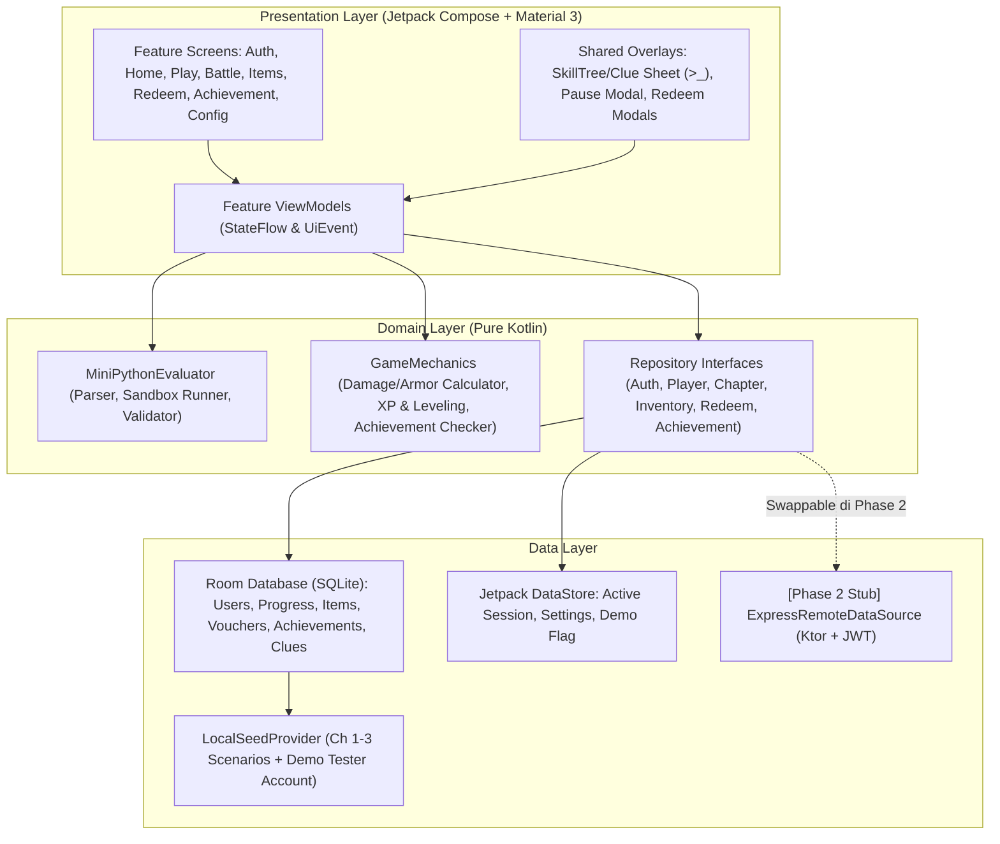
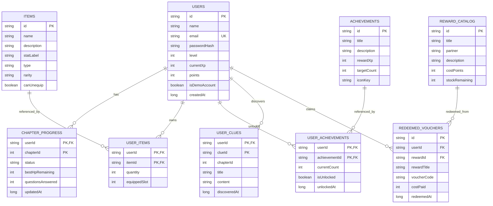

# Software Requirements Specification (SRS) — Code of The Mystery

> **Versi Dokumen:** 1.0  
> **Tanggal:** 20 November 2026  
> **Project Android:** `com.example.codeofthemistery`  
> **Referensi Terkait:** [PRD.md](file:///d:/projects/Android/code-of-the-mistery/docs/PRD.md), [UX - Code of The Mystery.md](file:///c:/Users/ACER/Downloads/UX%20-%20Code%20of%20The%20Mystery.md), Figma `UX Coftery`

---

## 1. Pendahuluan

### 1.1 Tujuan Dokumen
Dokumen **Software Requirements Specification (SRS)** ini mendefinisikan spesifikasi teknis, arsitektur perangkat lunak, kebutuhan fungsional (`FR`), kebutuhan non-fungsional (`NFR`), skema basis data lokal, spesifikasi *Mini Python Evaluator*, kontrak *Repository* (untuk migrasi ke backend Express + JWT), serta rencana pengujian aplikasi Android **Code of The Mystery**.

### 1.2 Ruang Lingkup Sistem
- **Phase 1 (Scope Implementasi Sekarang):** Aplikasi mobile Android berbasis **Kotlin** dan **Jetpack Compose** yang bekerja **offline-first** menggunakan **Room Database** dan **Jetpack DataStore**, dilengkapi **Mini Python Evaluator** lokal dan **Custom Compose Sprite Frame Animator**.
- **Phase 2 (Siap Integrasi di Masa Depan):** Penggantian implementasi *DataSource* lokal di balik interface `Repository` dengan klien HTTP (**Ktor Client** / Retrofit) menuju backend **Express.js + JWT** serta OAuth Google/Facebook nyata, tanpa mengubah layer UI maupun ViewModel.

### 1.3 Definisi & Akronim
- **UDF:** *Unidirectional Data Flow* (UI mengirim *Event/Intent* ke ViewModel; ViewModel memancarkan *UiState* melalui `StateFlow`).
- **HP:** *Health Point* pemain dalam satu sesi chapter (maksimal `6/6`).
- **VN:** *Visual Novel* (penyampaian materi & cerita lewat dialog interaktif berurutan).
- **Koin:** Framework *Dependency Injection* pure-Kotlin yang tidak bergantung pada code-generation KSP/Kapt.
- **Evaluator:** Komponen domain Kotlin yang mem-parsing, mengeksekusi secara aman (*sandboxed*), dan memvalidasi kode Python sederhana dari editor `MAIN.PY`.

---

## 2. Deskripsi Umum & Lingkungan Sistem

### 2.1 Lingkungan & Konfigurasi Build Saat Ini
Mengacu pada [gradle/libs.versions.toml](file:///d:/projects/Android/code-of-the-mistery/gradle/libs.versions.toml) dan [app/build.gradle.kts](file:///d:/projects/Android/code-of-the-mistery/app/build.gradle.kts):
- **Bahasa Pemrograman:** Kotlin `2.2.10`
- **Android Gradle Plugin (AGP):** `9.5.1`
- **Minimum SDK:** API `24` (Android 7.0)
- **Compile & Target SDK:** API `37`
- **UI Toolkit:** Jetpack Compose (BOM `2026.02.01`) + Material 3
- **Orientasi Layar:** Portrait (`1080x1920` basis desain Figma)

### 2.2 Arsitektur Sistem (Clean MVVM + Repository Abstraction)



---

## 3. Spesifikasi Tech Stack & Struktur Kode

### 3.1 Daftar Library yang Digunakan
| Kategori | Library / Artefak | Keterangan |
| :--- | :--- | :--- |
| **Core & Lifecycle** | `androidx.core:core-ktx`, `androidx.lifecycle:lifecycle-runtime-ktx`, `androidx.lifecycle:lifecycle-viewmodel-compose`, `androidx.lifecycle:lifecycle-runtime-compose` | Lifecycle & `collectAsStateWithLifecycle()` |
| **UI & Icons** | Jetpack Compose BOM `2026.02.01`, `material3`, `androidx.compose.material:material-icons-extended` | Komponen UI & ikon standar |
| **Navigation** | `androidx.navigation:navigation-compose` + `org.jetbrains.kotlinx:kotlinx-serialization-json` | Type-safe `@Serializable` routes |
| **Dependency Injection** | `io.insert-koin:koin-androidx-compose` | Pure-Kotlin DI, aman terhadap Kotlin `2.2.10` + AGP `9.5.1` |
| **Local Database** | `androidx.room:room-runtime`, `androidx.room:room-ktx` (compiler via KSP versi selaras Kotlin `2.2.10`) | Persisten data relasional offline-first |
| **Preferences** | `androidx.datastore:datastore-preferences` | Sesi aktif (`activeUserId`) & konfigurasi |
| **Coroutines** | `org.jetbrains.kotlinx:kotlinx-coroutines-android` | Timer dialog VN, animasi frame, operasi DB async |
| **Testing** | `junit:junit`, `org.jetbrains.kotlinx:kotlinx-coroutines-test`, `androidx.compose.ui:ui-test-junit4` | Unit test evaluator/kalkulator & UI test |
| **Phase 2 (Nanti)** | `io.ktor:ktor-client-okhttp`, `ktor-client-content-negotiation`, `ktor-serialization-kotlinx-json` | Klien API untuk backend Express + JWT |

### 3.2 Struktur Package (`com.example.codeofthemistery`)
```text
com.example.codeofthemistery/
├── CodeMysteryApp.kt                # Application class (startKoin + seed check)
├── MainActivity.kt                  # Single-activity host + Theme + Root NavHost
├── core/
│   ├── di/                          # Koin modules (appModule, dataModule, domainModule, viewModelModule)
│   ├── navigation/                  # Route definitions & BottomNavScaffold
│   ├── theme/                       # Color.kt, Type.kt (Cascadia Code), Theme.kt
│   ├── ui/                          # Shared UI: TerminalTopBar, NeonButton, SpriteAnimator, SkillClueSheet
│   └── util/                        # HashUtil, DateUtil, Result wrapper
├── domain/
│   ├── model/                       # Domain models (User, Chapter, SceneStep, Item, Voucher, Achievement, SkillNode)
│   ├── repository/                  # Interfaces (AuthRepository, PlayerRepository, ChapterRepository, dsb.)
│   ├── evaluator/                   # MiniPythonEvaluator, ExecutionResult, ValidationRule
│   └── mechanics/                   # BattleCalculator (HP/Armor), LevelCalculator, AchievementEngine
├── data/
│   ├── local/
│   │   ├── db/                      # AppDatabase, TypeConverters, DAOs
│   │   ├── entity/                  # Room @Entity classes
│   │   ├── datastore/               # SessionPreferences
│   │   └── seed/                    # ChapterContentSeed (Ch.1-3), ItemsSeed, RewardsSeed, DemoAccountSeed
│   ├── remote/                      # Placeholder interface/stub untuk Express + JWT Phase 2
│   └── repository/                  # Implementasi Repository (Room + DataStore)
└── feature/
    ├── auth/                        # Splash, SignUp, Login (+Demo Tester), ForgotPassword, TerminalLoading
    ├── home/                        # MainMenuScreen & HomeViewModel
    ├── play/                        # ChapterMapScreen & PlayViewModel
    ├── battle/                      # GameplayScreen (VN, Quiz, MAIN.PY Editor, Output, Loot Claim, Complete)
    ├── items/                       # ItemsScreen & ItemsViewModel
    ├── redeem/                      # RedeemScreen, Modals, VoucherHistorySheet & RedeemViewModel
    ├── achievement/                 # AchievementScreen & AchievementViewModel
    └── config/                      # ConfigScreen & ConfigViewModel
```

---

## 4. Kebutuhan Fungsional (`FR`)

### `FR-01` — Splash & Resolusi Sesi Awal
- **Deskripsi:** Saat aplikasi dibuka, tampilkan `SplashScreen` minimal `1.200 ms`, lalu cek `activeUserId` di `DataStore`.
- **Aturan:**
  - Jika `activeUserId` valid dan ada di tabel `users` → arahkan ke `TerminalLoading` → `MainMenu`.
  - Jika tidak ada sesi → arahkan ke `LoginScreen` (dengan navigasi ke `SignUpScreen` dan `ForgotPasswordScreen`).

### `FR-02` — Autentikasi Lokal, Lupa Password & Demo Tester
- **Registrasi (`SignUp`):**
  - Validasi: `nama` tidak kosong (min. 2 karakter), `email` valid format regex email dan belum terdaftar di Room, `password` min. 6 karakter, `confirmPassword == password`.
  - Password disimpan dalam bentuk hash (SHA-256 + salt per user) ke tabel `users`.
  - Akun baru otomatis mendapat: `level = 1`, `xp = 0`, `points = 0`, `chapter 1 = UNLOCKED`, `chapter 2..7 = LOCKED`, item awal `Laptop` (terpasang di slot 1).
- **Login:**
  - Verifikasi `email` & hash `password`. Jika cocok, simpan `activeUserId` ke `DataStore`.
  - **Tombol "Demo Account":** Memuat atau membuat ulang user `demo@codeofthemistery.app` (`Player Name`, `Level 2`, `697 XP`, `15.000 Points`, `Laptop` & `Firewall Shield` equipped, `Syntax Potion x3` tersedia, Ch.1–3 terbuka/siap dimainkan).
  - **OAuth Google / Facebook (Placeholder):** Mengetuk ikon Google/Facebook menampilkan dialog informasi (*"Integrasi OAuth Google/Facebook akan aktif saat backend Express + JWT terhubung"*).
- **Forgot Password:**
  - Langkah 1: Cek email terdaftar di Room → generate kode OTP 6 digit simulasi dan tampilkan di snackbar/notifikasi UI lokal untuk pengujian.
  - Langkah 2: Verifikasi OTP 6 digit.
  - Langkah 3: Update hash password baru → layar `loading pw` → kembali ke `Login`.

### `FR-03` — Main Menu (`HOME`) & Sistem Leveling
- Menampilkan profil user aktif dari `Flow<UserProgress>`:
  - Formula Level: `xpRequiredForNextLevel(level) = level * 750` (Level 1→2 butuh `750 XP`, Level 2→3 butuh `1.500 XP`, dst., sesuai Figma `697 XP / 1,500 XP` pada Level 2).
  - Menampilkan `Poin Terkumpul`, `Chapter Terselesaikan (completedCount / 7)`, `Pencapaian Didapatkan (unlockedCount / totalAchievements)`.
  - Kartu `Current Chapter` menampilkan chapter terbaru yang berstatus `UNLOCKED` atau `IN_PROGRESS` beserta tombol `PLAY`.

### `FR-04` — Peta Chapter (`PLAY`)
- Menampilkan daftar 7 node chapter pada jalur vertikal melengkung (Canvas path + node composables):
  - Chapter 1–3 memiliki skenario penuh yang dapat dimainkan.
  - Chapter 4–7 tampil dengan status `LOCKED` (`🔒`); jika diketuk menampilkan dialog pratinjau materi & info bahwa chapter akan dibuka pada pembaruan lanjutan.
  - Mengetuk chapter yang `UNLOCKED`/`COMPLETED` membuka `Loafing Game` singkat → masuk `GameplayScreen(chapterId)`.

### `FR-05` — Visual Novel Viewport, Custom Sprite Animator & Clue Collection
- **Viewport Animasi (`SpriteViewport`):**
  - Menerima `SceneVisualState` (`backgroundRes`, `heroAnimState`, `enemyType`, `enemyAnimState`, `dialogBubbleText`, `showClaimButton`).
  - `CustomSpriteAnimator` mengganti frame drawable menggunakan `LaunchedEffect` dengan FPS terkontrol (~8–12 FPS untuk pixel-art):
    - Hero states: `IDLE`, `WALK`, `RUN`, `SKILL_1`, `SKILL_2`, `DEATH`.
    - Enemy states: `NONE`, `DRONE_ATTACK`, `DRONE_DEATH`, `GOLEM_IDLE`, `GOLEM_DEATH`.
- **Narasi Visual Novel:**
  - Teks dialog ditampilkan bertahap (*typewriter effect*). Tap pada panel dialog mempercepat teks penuh, tap kedua memajukan ke step berikutnya.
  - Jika step memiliki `clueId`, sistem otomatis menyimpan clue ke tabel `user_clues` dan memunculkan toast/indikator kecil `Clue Baru Tersimpan`.

### `FR-06` — Sistem Battle, HUD HP `6/6` & Efek Equipment
- Setiap sesi chapter dimulai dengan `currentHp = 6`, `maxHp = 6`.
- **Tipe Tantangan:**
  1. **Quiz MCQ:** 4 opsi pilihan ganda. Jawaban benar → hero memicu animasi `SKILL_1`, musuh terkena hit.
  2. **Coding Challenge (`MAIN.PY`):** Dijelaskan pada `FR-07`. Jawaban benar → hero memicu animasi `SKILL_2`, musuh tumbang (`DEATH`).
- **Perhitungan Damage & Armor Buff (`BattleCalculator`):**
  - Base damage kesalahan = `1 HP` (untuk kuis/coding biasa) atau `2 HP` (untuk Boss Battle Ch.3).
  - Jika **`Firewall Shield`** terpasang di equipment slot:
    - Penalti kesalahan pertama di setiap chapter diblokir (`0 damage`, tampil pesan *"Firewall Shield menyerap error!"*), dan untuk kesalahan berikutnya damage dikurangi `1` (minimal `1` pada Boss Battle, atau menjadi `0` sekali lagi bila rarity Shield lebih tinggi).
  - Jika **`Syntax Potion`** diketuk pada Quick Item Bar saat `currentHp < 6`:
    - Memulihkan `+4 HP` (di-clamp maksimal `6`), mengurangi `quantity` item di Room sebanyak `1`.
- **Game Over:** Jika `currentHp == 0`, animasi hero `DEATH` diputar dan dialog *Mission Failed* tampil dengan pilihan **Coba Lagi** (reset HP `6/6` ke awal chapter) atau **Keluar ke Menu**.

### `FR-07` — In-App Code Editor (`MAIN.PY`) & Mini Python Evaluator
- **Komponen Editor:**
  - Menampilkan header tab `<> MAIN.PY`, nomor baris/highlight keyword Python dasar (`if`, `else`, `elif`, `for`, `while`, `def`, `True`, `False`, `print`), template kode dari skenario level (dengan bagian yang dapat diisi/diedit pemain), tombol **`Reset Kode`**, tombol **`Hint`** (aktif karena `Laptop` terpasang), dan tombol **`Jalankan`**.
- **Mini Python Evaluator Engine (Domain Kotlin):**
  - Berjalan 100% lokal, sinkron/coroutine `< 100 ms`, dan **aman dari infinite loop** (batas maksimum `200` iterasi loop per eksekusi).
  - **Fitur Sintaks Python yang Didukung:**
    1. Komentar (`# ...`) dan string literal (`"..."` atau `'...'`).
    2. Assignment variabel (`nama = "Dokja"`, `energy = 70`, `shields_active = True`, `hp = hp - 1`).
    3. Tipe data: `String`, `Int`, `Double` (float), `Boolean` (`True`/`False`), serta `List` sederhana (`[1, 2, 3]`).
    4. Operasi aritmatika (`+`, `-`, `*`, `/`, `%`) dan penggabungan string (`+`).
    5. Kondisi perbandingan (`==`, `!=`, `>`, `<`, `>=`, `<=`) dan logika (`and`, `or`, `not`).
    6. Blok `if ... :` / `elif ... :` / `else:` berbasis indentasi (2 atau 4 spasi).
    7. Perulangan `for i in range(...)` dan `while <kondisi>:` (dengan batas iterasi).
    8. Fungsi `print(...)` dengan multi-argumen dipisah koma (menghasilkan baris ke buffer `stdout`).
    9. Definisi fungsi sederhana `def nama_fungsi(param): ... return ...` untuk skenario Boss Battle Ch.3.
  - **Validasi Level (`ValidationRule`):**
    - Mengecek kombinasi: (a) tidak ada syntax/runtime error, (b) nilai akhir variabel target sesuai (misal `nama` bertipe non-empty String, `total_power` sesuai hasil kondisi `energy > 50`), (c) output `stdout` mengandung pola yang diharapkan, dan/atau (d) keyword wajib digunakan (misal `if`, `for`, `def`).
  - **Output Panel (`OUTPUT`):**
    - Jika lolos → menampilkan `Code Executed Successfully With Exit Code 0;` beserta hasil `stdout` dan melanjutkan fase battle (`SKILL_2` + musuh kalah).
    - Jika gagal → menampilkan pesan error terstruktur yang edukatif (contoh: `SyntaxError di baris 5: pastikan ada tanda ':' setelah kondisi if` atau `LogicError: nilai total_power belum sesuai`), lalu memicu penalti HP sesuai `FR-06`.

### `FR-08` — Inventory, Equipment (3 Slot), Loot Box & Rarity
- **3 Slot Aktif:**
  - Slot 1 terkunci untuk `Laptop` (`DEFAULT ITEM`, tidak dapat di-unequip).
  - Slot 2 & Slot 3 dapat diisi oleh item yang dimiliki (`Firewall Shield`, `Syntax Potion`, atau item hasil Loot Box).
  - Perubahan slot langsung tersimpan ke tabel `user_items` di Room sehingga langsung terbaca di Quick Item Bar `GameplayScreen`.
- **Loot Box (`CLAIM >>`):**
  - Saat Boss/Musuh akhir chapter kalah, tombol `CLAIM >>` di viewport memicu modal **Loot Box** yang memberikan reward item atau tambahan kuantitas item berdasarkan akurasi jawaban di chapter tersebut:
    - HP tersisa `6/6` → peluang Rarity **EPIC**
    - HP tersisa `4–5` → Rarity **RARE**
    - HP tersisa `1–3` → Rarity **COMMON**

### `FR-09` — Milestone Reward Center (`Redeem`) & Riwayat Voucher
- Daftar katalog hadiah diambil dari tabel `reward_catalog` (termasuk `Shopee Rp70k Voucher`, `Tokopedia Rp50k Voucher`, `Dana Rp50k`, `GitHub Copilot (1 Bulan)`, `ChatGPT Plus (1 Bulan)`).
- **Validasi Penukaran:**
  - Jika `user.points < reward.cost` → tampilkan `Modal Poin Tidak Cukup`.
  - Jika `reward.stock == 0` → tombol non-aktif (`Stok Habis`).
  - Jika valid → tampilkan Modal Konfirmasi (`Poin Anda`, `Harga`, `Sisa`).
- **Transaksi Atomik Room (`@Transaction`):**
  1. Kurangi `user.points -= reward.cost`.
  2. Jika `reward.stock != null`, kurangi `reward.stock -= 1`.
  3. Generate kode unik format `COTM-<KODE_PARTNER>-<4_ALPHANUM>` dan simpan ke tabel `redeemed_vouchers`.
  4. Tampilkan `Modal Success` dengan kode voucher yang dapat disalin dan tersimpan di **Riwayat Voucher**.

### `FR-10` — Achievement, Skill Tree (`>_`) & Config
- **Achievement Engine:** Mengevaluasi kondisi pencapaian setiap kali event terjadi (`CodeExecuted`, `ChapterCompleted`, `ItemEquipped`, `VoucherRedeemed`) dan mencatat progres (`currentProgress / targetProgress`) di `user_achievements`. Saat mencapai target, sistem menambahkan bonus XP ke user dan memunculkan banner notifikasi achievement.
- **Terminal Sheet (`>_`):** Dapat diakses dari Top Bar atau menu Pause; menampilkan tab **Skill Tree** (status `Locked / Learning / Mastered` per topik Python) dan tab **Clue Log** (daftar materi yang sudah dibuka).
- **Config:** Ubah nama akun, toggle Haptic/Audio feedback (tersimpan di `DataStore`), tombol Reset Data Demo (untuk mengulang demo presentasi), info kelompok, dan tombol `Logout`.

---

## 5. Arsitektur Data, Skema Room & Kontrak Integrasi

### 5.1 Entity-Relationship Diagram (Room SQLite)



### 5.2 Skema `Jetpack DataStore` (`session_prefs`)
| Key | Tipe | Default | Fungsi |
| :--- | :--- | :--- | :--- |
| `active_user_id` | `String?` | `null` | Menyimpan ID user yang sedang login |
| `haptics_enabled` | `Boolean` | `true` | Mengaktifkan getaran umpan balik saat battle/error |
| `sound_enabled` | `Boolean` | `true` | Preferensi suara/SFX (siap untuk `SoundPool` jika aset audio ditambah) |
| `last_played_chapter_id` | `Int` | `1` | Menentukan chapter default pada kartu `Current Chapter` di `Main Menu` |

### 5.3 Kontrak Interface Repository (Kesiapan Phase 2 Express + JWT)
Semua `ViewModel` hanya berkomunikasi dengan interface di `domain/repository/`:
- `AuthRepository`: `login(email, password)`, `register(name, email, password)`, `loginAsDemoTester()`, `requestPasswordResetOtp(email)`, `resetPassword(email, otp, newPassword)`, `logout()`, `observeActiveUser(): Flow<User?>`.
- `ChapterRepository`: `observeChapters(userId): Flow<List<ChapterSummary>>`, `getChapterScript(chapterId): ChapterScript`, `completeChapter(userId, chapterId, hpRemaining, answeredCount, earnedXp, earnedPoints)`.
- `InventoryRepository`: `observeInventory(userId): Flow<List<OwnedItem>>`, `equipItem(userId, itemId, slot)`, `unequipItem(userId, itemId)`, `consumeItem(userId, itemId)`, `grantLootItem(userId, itemId, qty)`.
- `RedeemRepository`: `observeCatalog(): Flow<List<RewardCatalog>>`, `observeVoucherHistory(userId): Flow<List<RedeemedVoucher>>`, `redeemReward(userId, rewardId): RedeemResult`.
- `AchievementRepository`: `observeAchievements(userId): Flow<List<AchievementProgress>>`, `observeClues(userId): Flow<List<UserClue>>`, `recordClue(userId, clue)`, `evaluateAndUnlock(userId, event): List<Achievement>`.

Di Phase 2, cukup tambahkan `ExpressAuthDataSource` & `ExpressSyncDataSource` menggunakan Ktor Client + `Authorization: Bearer <jwt>` di layer `data/`, sementara `Room` bertindak sebagai local cache.

---

## 6. Spesifikasi Antarmuka & Navigasi (`Navigation Graph`)

### 6.1 Type-Safe Routes (`kotlinx.serialization`)
```kotlin
@Serializable object SplashRoute
@Serializable object LoginRoute
@Serializable object SignUpRoute
@Serializable object ForgotPasswordRoute
@Serializable data class TerminalLoadingRoute(val destination: String)

@Serializable object MainHubRoute       // Hosts BottomNav: Home, Items, Redeem, Config
@Serializable object AchievementRoute
@Serializable object ChapterMapRoute
@Serializable data class GameLoadingRoute(val chapterId: Int)
@Serializable data class GameplayRoute(val chapterId: Int)
```

### 6.2 Aturan UI Kustom
- **Custom Code Editor (`MAIN.PY`):** Menggunakan `BasicTextField` dengan font `Cascadia Code`, nomor baris di sebelah kiri, penyorotan warna sintaks sederhana via `AnnotatedString` (`VisualTransformation`), dan tombol cepat bantu ketik simbol Python (`=`, `:`, `"`, `()`, `>`, indent) di atas keyboard agar nyaman diketik di layar HP!
- **Accessibility & Touch Target:** Seluruh tombol interaktif (`PLAY`, `Jalankan`, `Tukar`, `Equip`, slot item, nav tab) memiliki ukuran sentuh minimal `48.dp`.

---

## 7. Kebutuhan Non-Fungsional (`NFR`)

| ID | Kategori | Spesifikasi Target |
| :--- | :--- | :--- |
| `NFR-01` | **Performa UI & Animasi** | Frame rate rendering Compose & sprite animation stabil di `60 fps`; perpindahan antar tab BottomNav `< 100 ms`. |
| `NFR-02` | **Kecepatan Evaluator** | Eksekusi `MiniPythonEvaluator` selesai dalam `< 100 ms` di background dispatcher (`Dispatchers.Default`) dengan proteksi batas loop (`MAX_STEPS = 200`). |
| `NFR-03` | **Integritas Transaksi** | Pengurangan poin saat Redeem dan pembukaan chapter berikutnya wajib berjalan di dalam `@Transaction` Room agar tidak terjadi saldo negatif atau data parsial. |
| `NFR-04` | **Keamanan Data Lokal** | Password tidak pernah disimpan sebagai *plain text* di SQLite (menggunakan salted SHA-256). |
| `NFR-05` | **Ketahanan Offline** | 100% fitur Phase 1 dapat dijalankan tanpa koneksi internet; ukuran APK dijaga tetap ringan (tanpa bundling interpreter native atau video MP4 besar). |
| `NFR-06` | **Kualitas & Testability** | Komponen logika inti (`MiniPythonEvaluator`, `BattleCalculator`, `LevelCalculator`, `RedeemUseCase`) wajib memiliki Unit Test otomatis berbasis JUnit 4. |

---

## 8. Rencana Pengujian & Traceability Matrix

| ID Kebutuhan | Skenario Uji | Metode Uji | Kriteria Lulus |
| :--- | :--- | :--- | :--- |
| `FR-02` | Register akun baru, login, reset password OTP, login via Demo Account | Unit Test (`AuthRepository`) + Manual/UI Test | Sesi tersimpan di DataStore; Demo Account memiliki `15.000 Poin` & `Firewall Shield`. |
| `FR-06` | Jawab salah dengan & tanpa `Firewall Shield`; pakai `Syntax Potion` | Unit Test (`BattleCalculator`) | Error pertama terblokir oleh Shield; Potion menambah `+4 HP` maks `6/6`; `0 HP` memicu Game Over. |
| `FR-07` | Jalankan kode Python benar, salah sintaks, salah logika, & `while True` | Unit Test (`MiniPythonEvaluatorTest`) | Kode benar exit `0` + `stdout` akurat; error sintaks tampil jelas; `while True` berhenti aman di batas langkah. |
| `FR-08` | Equip/Unequip slot 2 & 3, coba unequip `Laptop`, klaim Loot Box | Integration Test (Room DAO) + Manual | `Laptop` tetap terkunci di slot 1; Loot Box menambah item sesuai rarity HP. |
| `FR-09` | Tukar voucher poin cukup vs tidak cukup | Unit/Integration Test (`RedeemRepository`) | Poin berkurang atomik, kode voucher tersimpan di Riwayat; poin kurang memunculkan modal error. |
| `FR-10` | Selesaikan Ch.1 → cek `Achievement`, `Skill Tree`, `Clue Log`, `Logout` | End-to-End Demo Flow | `Variable Explorer 1` terbuka, XP bertambah, Ch.2 terbuka, Logout menghapus sesi DataStore. |
